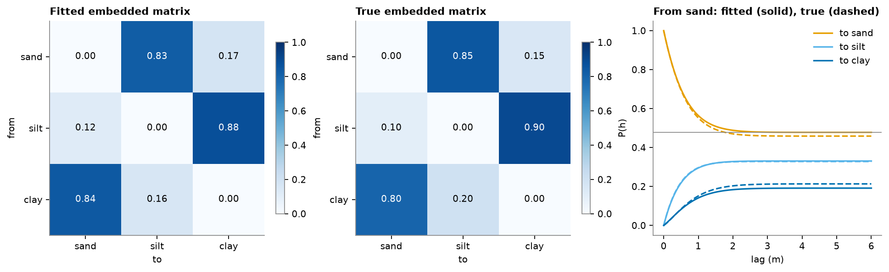

# Embedded Markov chains

Twelve holes cut fining-upward cycles of sand, silt and clay. An embedded chain counts which bed
follows which, ignoring thickness, and the bed thicknesses give the continuous-lag generator `Q`
with `P(h) = exp(Q h)`.

```python
import matplotlib.pyplot as plt
import numpy as np
import transiograms as tg
from common import GRAY, save

d = tg.datasets.varved_sequence(seed=0)
names = tg.Categories(d["names"], colors=["#e69f00", "#56b4e9", "#0072b2"])
truth = tg.MarkovChain.from_json(d["generator"])
print(f"{len(np.unique(d['HOLE_ID']))} holes, {len(d['CODE'])} beds")
```

```text
12 holes, 448 beds
```

Intervals go in top-down by depth. The default direction "up" reads each hole from its base,
older to younger, so a transition sand to silt means silt lies on sand.

```python
chain = tg.MarkovChain("embedded").fit("CODE", holes="HOLE_ID", from_="FROM", to="TO", data=d)
print(chain.transition_matrix.round(3))
print("mean thickness (m):", chain.mean_lengths.round(2), "true:", truth.mean_lengths)
print("volume proportions:", chain.proportions.round(3))
```

```text
[[0.    0.828 0.172]
 [0.121 0.    0.879]
 [0.84  0.16  0.   ]]
mean thickness (m): [1.2  0.83 0.46] true: [1.2 0.8 0.5]
volume proportions: [0.478 0.331 0.191]
```

The quasi-independence test asks whether beds follow each other at random, given how often
each category occurs; the difference matrix shows the preferred paths.

```python
test = chain.independence_test()
print(f"G = {test.statistic:.1f}, df = {test.df}, p = {test.p_value:.1e}")
print(chain.difference_matrix().round(3))
entropy = chain.entropy()
print("post-entropy (bits):", entropy.post.round(3), "of at most 1 for three categories")
```

```text
G = 234.9, df = 1, p = 5.1e-53
[[ 0.     0.35  -0.35 ]
 [-0.36   0.     0.36 ]
 [ 0.338 -0.338  0.   ]]
post-entropy (bits): [0.663 0.531 0.634] of at most 1 for three categories
```

Fitted and true embedded matrices side by side, and the transition probabilities the generator
implies against lag for sand.

```python
fig, axes = plt.subplots(1, 3, figsize=(12, 3.6), layout="constrained")
tg.plot.transition_matrix(chain, categories=names, ax=axes[0])
axes[0].set_title("Fitted embedded matrix")
tg.plot.transition_matrix(truth, categories=names, ax=axes[1])
axes[1].set_title("True embedded matrix")
h = np.linspace(0, 6, 120)
fitted, exact = chain.transition_at(h), truth.transition_at(h)
for j, color in enumerate(names.colors):
    axes[2].plot(h, fitted[:, 0, j], color=color, label=f"to {names.names[j]}")
    axes[2].plot(h, exact[:, 0, j], color=color, ls="--")
axes[2].axhline(chain.proportions[0], color=GRAY, lw=0.8)
axes[2].set(xlabel="lag (m)", ylabel="P(h)", title="From sand: fitted (solid), true (dashed)")
axes[2].legend()
save(fig, "matrices")
```



The proportion identity ties the three summaries together: volume proportion equals bed
frequency times mean thickness, normalised.

```python
nu, length = chain.bed_frequencies, chain.mean_lengths
print(np.abs(chain.proportions - nu * length / np.sum(nu * length)).max())
print("rows sum to 1:", np.allclose(chain.transition_matrix.sum(axis=1), 1.0, atol=1e-12))
```

```text
5.551115123125783e-17
rows sum to 1: True
```

Full script: [`example_01_01.py`](example_01_01.py)
