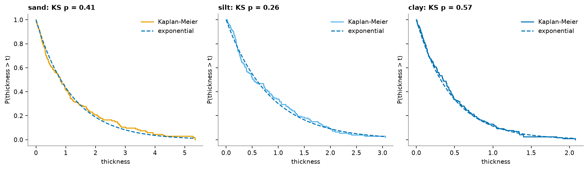
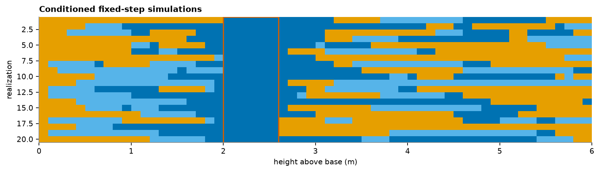
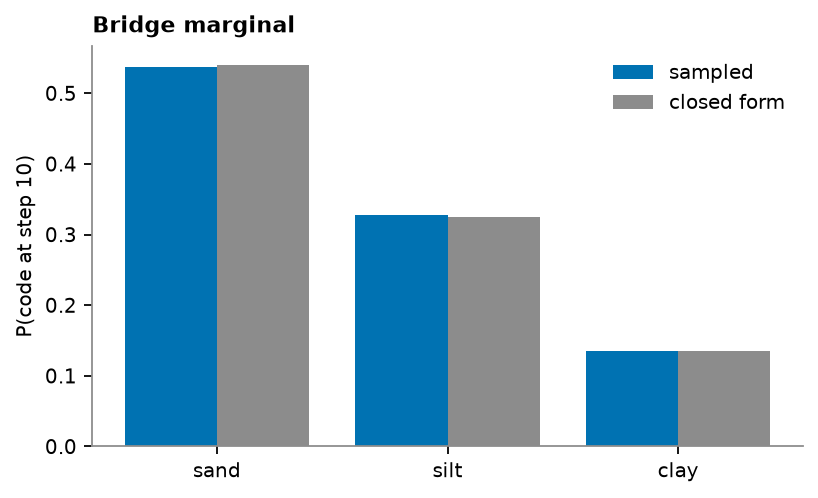

# Tests, sojourns and conditional simulation

A fixed-step chain reads a regularly sampled log at its sample spacing. This page checks the
Markov order, compares the bed thicknesses with the exponential law a Markov chain implies, and
draws logs that honour logged intervals.

```python
import matplotlib.pyplot as plt
import numpy as np
import varvite as vv
from common import ACCENT, GRAY, HIGHLIGHT, save
from matplotlib.colors import ListedColormap

d = vv.datasets.varved_sequence(seed=0)
names = vv.Categories(d["names"], colors=["#e69f00", "#56b4e9", "#0072b2"])
step = 0.1
depth, holes, codes = [], [], []
for h in np.unique(d["HOLE_ID"]):
    at = d["HOLE_ID"] == h
    z = np.arange(step / 2, d["TO"][at][-1], step)
    idx = np.searchsorted(d["TO"][at], z, side="right")
    depth.append(z)
    holes.append(np.full(z.size, h))
    codes.append(d["CODE"][at][idx])
log = {"HOLE_ID": np.concatenate(holes), "DEPTH": np.concatenate(depth), "CODE": np.concatenate(codes)}
fixed = vv.MarkovChain("fixed").fit("CODE", holes="HOLE_ID", depth="DEPTH", data=log)
print(f"step {fixed.step:.2f} m")
print(fixed.transition_matrix.round(3))
```

```text
step 0.10 m
[[0.924 0.064 0.013]
 [0.023 0.883 0.094]
 [0.152 0.041 0.807]]
```

Order 2 against order 1, and AIC and BIC for orders 0 to 3, all fitted on the same
transitions. Bed persistence makes a sampled log strongly first order.

```python
t = vv.order_test("CODE", order=2, holes="HOLE_ID", depth="DEPTH", data=log)
print(f"order 2 vs 1: G = {t.statistic:.1f}, df = {t.df}, p = {t.p_value:.2f}")
table = vv.select_order("CODE", max_order=3, holes="HOLE_ID", depth="DEPTH", data=log)
print("BIC by order:", table["bic"].round(0), "best order:", table["order"][np.argmin(table["bic"])])
```

```text
order 2 vs 1: G = 13.9, df = 12, p = 0.31
BIC by order: [7364. 2869. 2954. 3220.] best order: 1
```

A Markov chain makes bed thickness exponential. The Kaplan-Meier curve treats the beds cut by
the top or base of a hole as censored; the bootstrap Kolmogorov-Smirnov test measures the gap.

```python
s = vv.sojourn("CODE", holes="HOLE_ID", from_="FROM", to="TO", data=d)
fig, axes = plt.subplots(1, 3, figsize=(12, 3.4), layout="constrained", sharey=True)
for code, ax in enumerate(axes):
    vv.plot.sojourn(s, code, ax=ax, color=names.colors[code])
    t = s.exponential_test(code, n_bootstrap=199, seed=0)
    ax.set_title(f"{names.names[code]}: KS p = {t.p_value:.2f}")
save(fig, "sojourns")
```



Twenty logs of 6 m from the fixed chain, conditioned on a logged clay interval between 2.0 and
2.6 m and sand at the base. Column 0 of each realization is the deepest sample, as the chain
runs upward. Each conditioned position keeps its code in every draw.

```python
sims = fixed.simulate(6.0, n=20, seed=3, hard_from=[0.0, 2.0], hard_to=[0.0, 2.6], hard_codes=[0, 2])
print(sims.shape, "clay at 2.0-2.6 m in all:", bool(np.all(sims[:, 20:26] == 2)))
fig, ax = plt.subplots(figsize=(10, 2.8), layout="constrained")
ax.imshow(
    sims,
    aspect="auto",
    cmap=ListedColormap(names.colors),
    interpolation="nearest",
    extent=(0, 6.0, 20.5, 0.5),
)
ax.axvspan(2.0, 2.6, fill=False, ec=HIGHLIGHT, lw=1.5)
ax.set(xlabel="height above base (m)", ylabel="realization", title="Conditioned fixed-step simulations")
save(fig, "simulations")
```

```text
(20, 60) clay at 2.0-2.6 m in all: True
```



Between two conditioning samples the sampler draws a Markov bridge. Its marginal at step `t`
has the closed form `(P^t)_aj (P^(n-t))_jb / (P^n)_ab`, which `vv.checks` computes in NumPy:

```python
p = fixed.transition_matrix
bridge = fixed.simulate(3.0, n=20_000, seed=5, hard_from=[0.0, 2.95], hard_codes=[0, 2])
t = 10
got = np.bincount(bridge[:, t], minlength=3) / len(bridge)
want = vv.checks.markov_bridge_marginal(p, 0, 2, 29, t)
print("sampled:", got.round(4))
print("closed form:", want.round(4))
fig, ax = plt.subplots(figsize=(5, 3), layout="constrained")
ax.bar(np.arange(3) - 0.2, got, 0.4, color=ACCENT, label="sampled")
ax.bar(np.arange(3) + 0.2, want, 0.4, color=GRAY, label="closed form")
ax.set_xticks(range(3), names.names)
ax.set(ylabel=f"P(code at step {t})", title="Bridge marginal")
ax.legend()
save(fig, "bridge")
```

```text
sampled: [0.537  0.3282 0.1348]
closed form: [0.5403 0.3252 0.1345]
```



Full script: [`example_01_02.py`](example_01_02.py)
