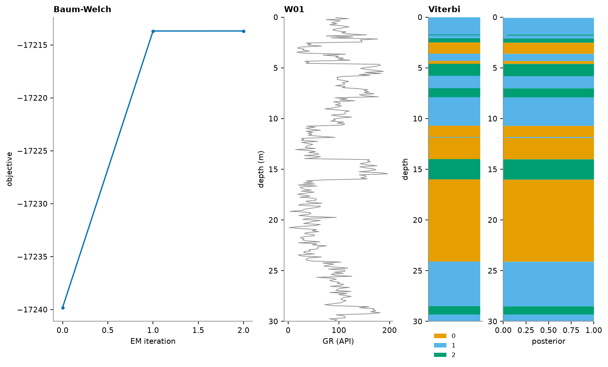

# Electrofacies from logs

Twenty wells log gamma ray (GR) and bulk density (RHOB) every 0.1 m. A hidden Markov model treats
the facies as a hidden sequence and each log reading as a draw from its facies' Gaussian; Baum-Welch
fits both, and Viterbi decodes the most likely facies column.

```python
import matplotlib.pyplot as plt
import numpy as np
import transiograms as tg

ACCENT, GRAY = "#0072b2", "#8c8c8c"

logs = tg.datasets.electrofacies_logs(seed=0)
x = np.column_stack([logs["GR"], logs["RHOB"]])
print(x.shape, "rows in", len(np.unique(logs["HOLE_ID"])), "wells")
```

```text
(6000, 2) rows in 20 wells
```

Three states, diagonal covariances, five seeded restarts. `ordering="mean"` labels the states by
increasing mean gamma ray, so state 0 is the cleanest. The rows run top-down and the model reads
them downward here.

```python
hmm = tg.HiddenMarkovModel(3, covariance_type="diag", n_init=5, seed=0, direction="down", ordering="mean")
hmm.fit(x, holes=logs["HOLE_ID"])
print("converged:", hmm.converged, "after", hmm.n_iter, "iterations")
print(hmm.transition.round(3))
for j, g in enumerate(hmm.distributions):
    print(f"state {j}: GR {g.mean[0]:6.1f}, RHOB {g.mean[1]:.3f}")
```

```text
converged: True after 2 iterations
[[0.953 0.031 0.017]
 [0.021 0.951 0.027]
 [0.032 0.026 0.942]]
state 0: GR   40.0, RHOB 2.651
state 1: GR   99.7, RHOB 2.450
state 2: GR  159.7, RHOB 2.652
```

Viterbi states against the true states. The fitted labels follow GR, the true ones follow the
generator, so a permutation maps one to the other.

```python
states = hmm.predict(x, holes=logs["HOLE_ID"])
truth = logs["STATE"]
table = np.zeros((3, 3), int)
np.add.at(table, (truth, states), 1)
print(table)
print(f"agreement after relabelling: {table.max(axis=1).sum() / table.sum():.1%}")
```

```text
[[2204    0    0]
 [   0 2209    0]
 [   0    0 1587]]
agreement after relabelling: 100.0%
```

Each EM iteration raises the objective (log-likelihood plus the log prior); the strip shows one
well with its decoded facies and the posterior probability of each.

```python
well = logs["HOLE_ID"] == "W01"
posterior = hmm.predict_proba(x[well])
fig = plt.figure(figsize=(10, 6), layout="constrained")
grid = fig.add_gridspec(1, 4, width_ratios=[2.2, 1.2, 0.6, 1.0])
a = fig.add_subplot(grid[0])
a.plot(hmm.history, marker="o", ms=3, color=ACCENT)
a.set(xlabel="EM iteration", ylabel="objective", title="Baum-Welch")
b = fig.add_subplot(grid[1])
b.plot(logs["GR"][well], logs["DEPTH"][well], color=GRAY, lw=0.8)
b.set(xlabel="GR (API)", ylabel="depth (m)", title="W01")
b.invert_yaxis()
c, p = fig.add_subplot(grid[2], sharey=b), fig.add_subplot(grid[3], sharey=b)
tg.plot.strip_log(states[well], depth=logs["DEPTH"][well], posterior=posterior, ax=[c, p])
c.set_title("Viterbi")
fig.savefig("segmentation.png")
```



A logged core interval fixes the facies between 10 and 12 m; `labels` clamps those rows and
the decoded column honours them. `sample_posterior` draws whole state columns from the
posterior, which carries the uncertainty between the clamps.

```python
labels = np.full(well.sum(), -1)
core = (logs["DEPTH"][well] > 10.0) & (logs["DEPTH"][well] < 12.0)
labels[core] = 2
clamped = hmm.predict(x[well], labels=labels)
print("core rows decoded as 2:", bool(np.all(clamped[core] == 2)))
draws = hmm.sample_posterior(x[well], n=200, seed=1, labels=labels)
print(
    "draws:", draws.shape, "rows with any disagreement:", int(np.sum(draws.min(axis=0) != draws.max(axis=0)))
)
```

```text
core rows decoded as 2: True
draws: (200, 300) rows with any disagreement: 1
```

The brute-force check: on an 8-step sequence, Viterbi and the forward log-likelihood equal an
exhaustive search over all 3^8 state paths.

```python
short = x[:8]
log_b = np.column_stack([g.log_density(short) for g in hmm.distributions])
ll, path, best, gamma, entropy = tg.checks.brute_force_hmm(hmm.start, hmm.transition, log_b)
vpath, vlp = hmm.viterbi(short)
print("same path:", bool(np.array_equal(vpath, path)), "log-probability gap:", abs(vlp[0] - best))
print("log-likelihood gap:", abs(hmm.score(short) - ll))
```

```text
same path: True log-probability gap: 7.105427357601002e-15
log-likelihood gap: 7.105427357601002e-15
```

Full script: [`example_02_01.py`](example_02_01.py)
