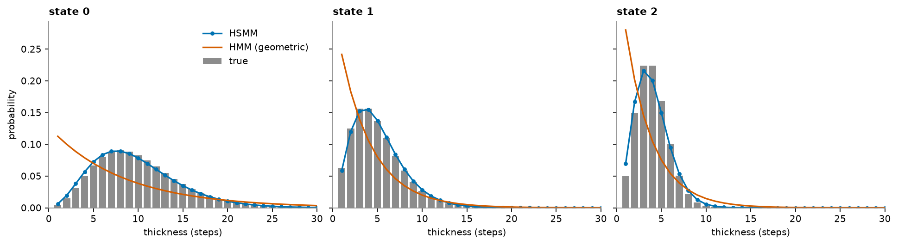
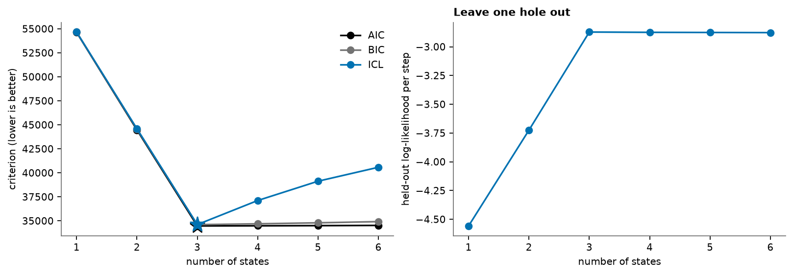

# Bed thickness and the number of states

An HMM makes every state last a geometric number of steps, so thin beds are always the most
likely. A hidden semi-Markov model gives each state its own duration law, here a negative
binomial with a mode away from one step. `select_states` then compares models with one to six
states by AIC, BIC, ICL and cross-validated likelihood.

```python
import matplotlib.pyplot as plt
import numpy as np
import transiograms as tg
from common import ACCENT, GRAY, HIGHLIGHT, save

truth = tg.HiddenSemiMarkovModel(
    [tg.Gaussian([m], 1.0) for m in (0.0, 2.5, 5.0)],
    [tg.NegativeBinomial(6.0, 0.4), tg.NegativeBinomial(4.0, 0.5), tg.ShiftedPoisson(3.0)],
    start=[0.4, 0.3, 0.3],
    transition=[[0.0, 0.6, 0.4], [0.5, 0.0, 0.5], [0.7, 0.3, 0.0]],
    max_duration=40,
    direction="down",
)
_, obs = truth.sample([400] * 8, seed=0)
print([o.shape for o in obs[:2]], "...")
```

```text
[(400, 1), (400, 1)] ...
```

An HMM and an HSMM with negative binomial durations, fitted to the same eight logs. The HSMM
recovers the bed-thickness law; the HMM can only offer geometric thicknesses.

```python
hmm = tg.HiddenMarkovModel(3, n_init=3, seed=0, direction="down", ordering="mean").fit(obs)
hsmm = tg.HiddenSemiMarkovModel(
    3, duration="negative_binomial", max_duration=40, n_init=3, seed=0, direction="down", ordering="mean"
).fit(obs)
print(f"log-likelihood: HMM {hmm.score(obs):.1f}, HSMM {hsmm.score(obs):.1f}")
print(f"BIC: HMM {hmm.bic(obs):.1f}, HSMM {hsmm.bic(obs):.1f}")
fig, axes = plt.subplots(1, 3, figsize=(12, 3.2), layout="constrained", sharey=True)
u = np.arange(1, 41)
for j, ax in enumerate(axes):
    ax.bar(u, truth.durations[j].pmf(40), color=GRAY, label="true")
    ax.plot(u, hsmm.durations[j].pmf(40), color=ACCENT, marker="o", ms=3, label="HSMM")
    a = hmm.transition[j, j]
    ax.plot(u, (1 - a) * a ** (u - 1), color=HIGHLIGHT, label="HMM (geometric)")
    ax.set(xlabel="thickness (steps)", title=f"state {j}", xlim=(0, 30))
axes[0].set_ylabel("probability")
axes[0].legend()
save(fig, "durations")
```

```text
log-likelihood: HMM -5919.0, HSMM -5848.4
BIC: HMM 11951.0, HSMM 11833.9
```



A geometric HSMM built from an HMM reproduces it exactly, which is the M3 equivalence check:

```python
same = tg.HiddenSemiMarkovModel.from_hmm(hmm, max_duration=400)
print("log-likelihood gap:", abs(same.score(obs) - hmm.score(obs)))
print("same Viterbi path:", all(np.array_equal(a, b) for a, b in zip(same.predict(obs), hmm.predict(obs))))
```

```text
log-likelihood gap: 2.7284841053187847e-12
same Viterbi path: True
```

Choosing K on the electrofacies logs. Samples 0.1 m apart are autocorrelated, so BIC can favour
too many states on dense logs; leave-one-hole-out likelihood is the honest check.

```python
logs = tg.datasets.electrofacies_logs(seed=0)
x = np.column_stack([logs["GR"], logs["RHOB"]])
table = tg.select_states(x, holes=logs["HOLE_ID"], states=range(1, 7), n_init=5, seed=0, direction="down")
for k, b, cv in zip(table["states"], table["bic"], table["cv_per_step"]):
    print(f"K = {k}: BIC {b:9.1f}, held-out log-likelihood per step {cv:.3f}")
fig, (a, b) = plt.subplots(1, 2, figsize=(10, 3.4), layout="constrained")
tg.plot.selection(table, ax=a)
b.plot(table["states"], table["cv_per_step"], marker="o", color=ACCENT)
b.set(xlabel="number of states", ylabel="held-out log-likelihood per step", title="Leave one hole out")
save(fig, "selection")
```

```text
K = 1: BIC   54662.4, held-out log-likelihood per step -4.558
K = 2: BIC   44542.5, held-out log-likelihood per step -3.725
K = 3: BIC   34602.6, held-out log-likelihood per step -2.872
K = 4: BIC   34691.0, held-out log-likelihood per step -2.875
K = 5: BIC   34795.8, held-out log-likelihood per step -2.876
K = 6: BIC   34919.0, held-out log-likelihood per step -2.877
```



Full script: [`example_03_01.py`](example_03_01.py)
