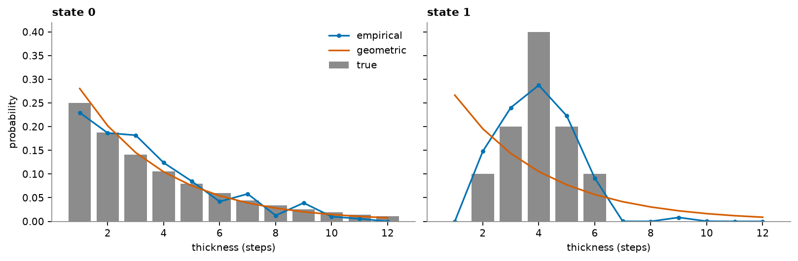

# Choosing a duration law

Each state of a hidden semi-Markov model needs a law for its thickness. `Geometric` is the law an
HMM implies, `EmpiricalDuration` puts free mass on every thickness up to `max_duration`, and the
parametric laws sit in between. Here the truth mixes a geometric state with an empirical one,
and `aic`, `bic` and `icl` weigh each fitted law against its parameter count. A brute-force check
over every state path of a short log closes the page.

```python
import matplotlib.pyplot as plt
import numpy as np
import varvite as vv
from common import ACCENT, GRAY, HIGHLIGHT, save

truth = vv.HiddenSemiMarkovModel(
    [vv.Gaussian([0.0], 1.0), vv.Gaussian([3.0], 1.0)],
    [vv.Geometric(0.25), vv.EmpiricalDuration([0.0, 0.1, 0.2, 0.4, 0.2, 0.1])],
    start=[0.5, 0.5],
    transition=[[0.0, 1.0], [1.0, 0.0]],
    max_duration=[30, 6],
    direction="down",
)
_, obs = truth.sample([300] * 6, seed=1)
print(len(obs), "logs of", obs[0].shape[0], "steps")
```

```text
6 logs of 300 steps
```

The same six logs fitted with each duration family. `score_samples` gives the log-likelihood of
each log, and its sum is `score`. The empirical law spends one free parameter per thickness, so
AIC, BIC and ICL show whether those parameters earn their keep.

```python
fits = {}
for family in ("geometric", "poisson", "negative_binomial", "empirical"):
    fits[family] = vv.HiddenSemiMarkovModel(
        2, duration=family, max_duration=30, seed=0, direction="down", ordering="mean"
    ).fit(obs)
for family, m in fits.items():
    per_log = m.score_samples(obs)
    assert np.isclose(per_log.sum(), m.score(obs))
    print(
        f"{family:>17}: log L {m.score(obs):8.1f}  AIC {m.aic(obs):8.1f}  "
        f"BIC {m.bic(obs):8.1f}  ICL {m.icl(obs):8.1f}"
    )
print("per-log log L (empirical):", np.round(fits["empirical"].score_samples(obs), 1))
```

```text
        geometric: log L  -3402.5  AIC   6819.0  BIC   6857.5  ICL   7338.5
          poisson: log L  -3377.5  AIC   6769.0  BIC   6807.5  ICL   7235.2
negative_binomial: log L  -3328.3  AIC   6674.5  BIC   6724.0  ICL   7102.8
        empirical: log L  -3303.8  AIC   6733.6  BIC   7079.8  ICL   7375.7
per-log log L (empirical): [-558.2 -559.7 -541.5 -553.9 -542.2 -548.4]
```

The empirical family reaches the highest log-likelihood, but it pays for 29 free thickness
probabilities per state, so BIC and ICL rank it last. The negative binomial,
two parameters per state, has the lowest AIC, BIC and ICL. In the figure the geometric family
fits state 0 and misses the peaked thickness of state 1; the empirical family follows both shapes.

```python
u = np.arange(1, 13)
fig, axes = plt.subplots(1, 2, figsize=(10, 3.2), layout="constrained", sharey=True)
for j, ax in enumerate(axes):
    ax.bar(u, truth.durations[j].pmf(30)[:12], color=GRAY, label="true")
    ax.plot(u, fits["empirical"].durations[j].pmf(30)[:12], color=ACCENT, marker="o", ms=3, label="empirical")
    ax.plot(u, fits["geometric"].durations[j].pmf(30)[:12], color=HIGHLIGHT, label="geometric")
    ax.set(xlabel="thickness (steps)", title=f"state {j}")
axes[0].set_ylabel("probability")
axes[0].legend()
save(fig, "laws")
```



Theory check: on eight steps there are 2^8 = 256 state paths. `vv.checks.brute_force_hsmm`
scores every one of them, with runs longer than `max_duration` excluded and the last run
right-censored, and must agree with the forward-backward and Viterbi recursions.

```python
x = obs[0][:8]
d = [law.pmf(int(m)) for law, m in zip(truth.durations, truth.max_duration)]
with np.errstate(divide="ignore"):
    log_d = [np.log(p) for p in d]
    log_survivor = [np.log(np.cumsum(p[::-1])[::-1]) for p in d]
log_b = np.column_stack([g.log_density(x) for g in truth.distributions])
lnl, best, _, gamma, _ = vv.checks.brute_force_hsmm(truth.start, truth.transition, log_d, log_survivor, log_b)
path, _ = truth.viterbi(x)
print("log-likelihood gap:", abs(truth.score(x) - lnl))
print("same Viterbi path:", np.array_equal(path, best))
print("largest posterior gap:", np.abs(truth.predict_proba(x) - gamma).max())
```

```text
log-likelihood gap: 1.7763568394002505e-15
same Viterbi path: True
largest posterior gap: 1.4988010832439613e-15
```

Full script: [`example_03_02.py`](example_03_02.py)
