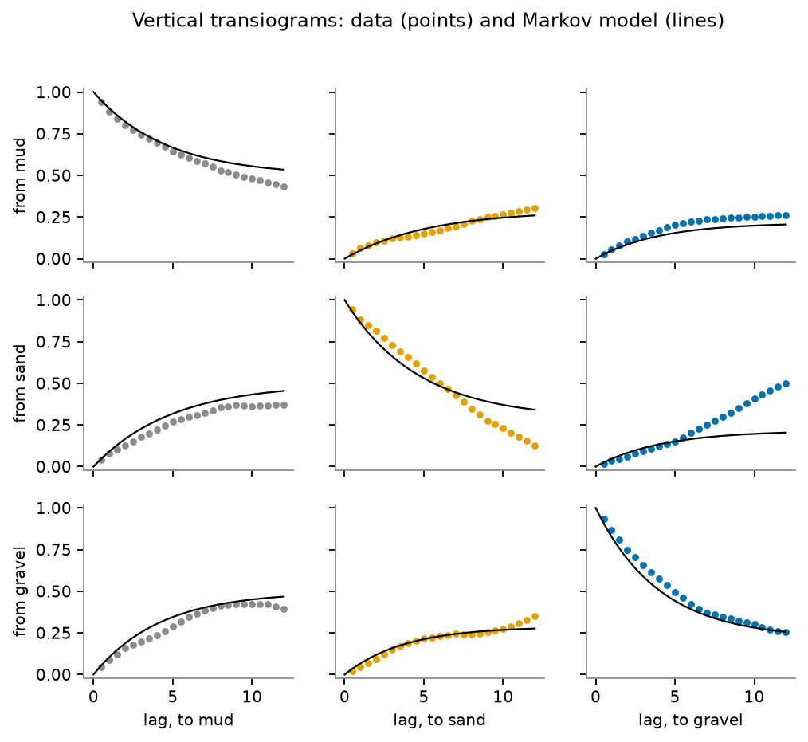
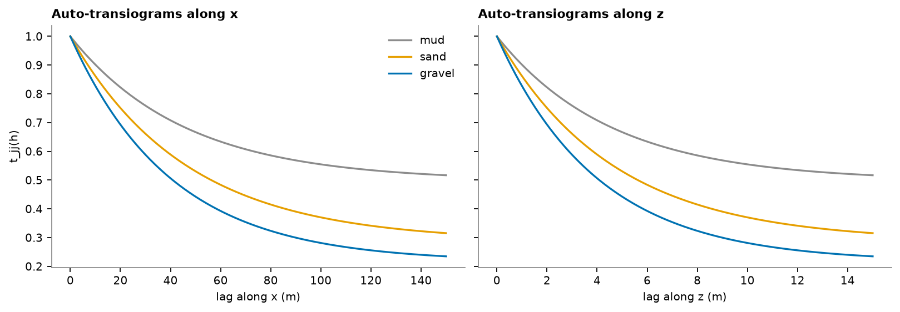

# Transiograms

A transiogram `t_ij(h)` is the probability of finding category `j` at lag `h` from a point in
category `i`. This page measures transiograms down 25 drillholes, fits a Markov model whose rows
always sum to one, and assembles the 3D transition model that the grid simulations use.

```python
import matplotlib.pyplot as plt
import numpy as np
import varvite as vv
from common import save

d = vv.datasets.layered_drillholes(seed=0)
names = vv.Categories(["mud", "sand", "gravel"], colors=["#8c8c8c", "#e69f00", "#0072b2"])
truth = vv.TransitionModel.from_json(d["model"])
p = np.bincount(d["CODE"], minlength=3) / len(d["CODE"])
print("sample proportions:", p.round(3), "model:", truth.proportions)
```

```text
sample proportions: [0.497 0.287 0.216] model: [0.5 0.3 0.2]
```

The downhole estimator measures overlap lengths of the logged intervals at each lag, so it
needs no lag tolerance. `fit_markov` fits a generator `R` with `T(h) = exp(R h)`, its sills
held at the sample proportions.

```python
lags = np.arange(0.5, 12.5, 0.5)
exp = vv.downhole_transiogram("CODE", holes="HOLE_ID", from_="FROM", to="TO", lags=lags, data=d)
vertical = vv.TransiogramModel.fit_markov(exp, proportions=p)
print("fitted vertical mean lengths (m):", (-1 / np.diag(vertical.rates)).round(2))
print("true:", truth.mean_lengths([0.0, 0.0, 1.0]).round(2))
fig, axes = vv.plot.transiogram(exp, vertical, h=np.linspace(0, 12, 200), categories=names)
fig.suptitle("Vertical transiograms: data (points) and Markov model (lines)")
save(fig, "vertical")
```

```text
fitted vertical mean lengths (m): [9.13 6.52 5.14]
true: [6. 4. 3.]
```



The same transiograms from points: composites at hole midpoints with a lag class every metre
and pairs only within a hole. Lag classes count pairs, so the probabilities match the downhole
estimator at whole-metre lags.

```python
xyz = np.column_stack([d["X"], d["Y"], d["Z"]])
points = vv.experimental_transiogram(
    xyz,
    d["CODE"],
    holes=d["HOLE_ID"],
    direction=(0.0, -90.0),
    lag=1.0,
    n_lags=6,
    lag_tolerance=0.25,
    angle_tolerance=1.0,
    pairs="same_hole",
)
whole = [1, 3, 5]
print("points, from mud at 1, 2, 3 m:  ", points.probabilities[:3, 0].round(4).tolist())
print("downhole, from mud at 1, 2, 3 m:", exp.probabilities[whole, 0].round(4).tolist())
```

```text
points, from mud at 1, 2, 3 m:   [[0.8814, 0.0647, 0.0539], [0.8005, 0.0984, 0.1011], [0.743, 0.1201, 0.1369]]
downhole, from mud at 1, 2, 3 m: [[0.8814, 0.0647, 0.0539], [0.8005, 0.0984, 0.1011], [0.743, 0.1201, 0.1369]]
```

Horizontal transiograms need lateral data; with only 25 holes, a common choice keeps the
vertical juxtapositions and scales mean lengths by a lateral-to-vertical ratio, here 10. Every
lag direction then interpolates its rates from the three principal axes.

```python
model = vv.TransitionModel(p, 0.1 * vertical.rates, 0.1 * vertical.rates, vertical.rates)
h = np.linspace(0.0, 150.0, 200)
fig, ax = plt.subplots(1, 2, figsize=(10, 3.4), layout="constrained", sharey=True)
for a, axis, label in ((ax[0], [1.0, 0.0, 0.0], "x"), (ax[1], [0.0, 0.0, 0.1], "z")):
    t = model.transition(np.outer(h, axis))
    for j, color in enumerate(names.colors):
        a.plot(h * np.linalg.norm(axis), t[:, j, j], color=color, label=names.names[j])
    a.set(xlabel=f"lag along {label} (m)", title=f"Auto-transiograms along {label}")
ax[0].set_ylabel("t_jj(h)")
ax[0].legend()
save(fig, "axes")
```



The M4 checks hold at any lag: entries non-negative, rows summing to one, the identity at zero
lag and the proportions far away.

```python
far = model.transition(np.array([[0.0, 0.0, 0.0], [3.0, 5.0, 1.0], [1e5, 0.0, 0.0]]))
print("rows sum to 1:", bool(np.allclose(far.sum(axis=2), 1.0, atol=1e-12)), "min entry:", far.min().round(6))
print("T(0) is the identity:", bool(np.array_equal(far[0], np.eye(3))))
print("T(far) rows:", far[2, 0].round(6))
```

```text
rows sum to 1: True min entry: 0.0
T(0) is the identity: True
T(far) rows: [0.497333 0.286667 0.216   ]
```

Full script: [`example_04_01.py`](example_04_01.py)
