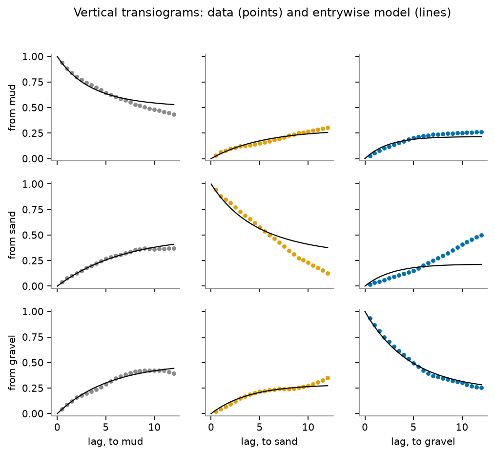
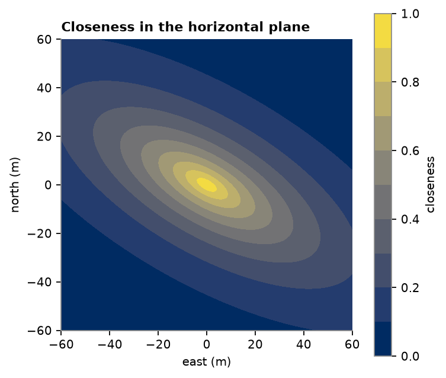

# Entrywise transiograms and closeness

A Markov model ties every transiogram to one generator. An entrywise model (Li 2007) fits one
curve per entry instead and lets each row's complement entry take up the slack, so rows still
sum to one. This page fits both to the same downhole data, builds a 3D model from mean lengths
with `TransitionModel.from_geology`, and maps its closeness, the distance measure that MCP and
the simulation neighbourhoods rank lags by.

```python
import matplotlib.pyplot as plt
import numpy as np
import varvite as vv
from common import save

d = vv.datasets.layered_drillholes(seed=0)
names = vv.Categories(["mud", "sand", "gravel"], colors=["#8c8c8c", "#e69f00", "#0072b2"])
p = np.bincount(d["CODE"], minlength=3) / len(d["CODE"])
lags = np.arange(0.5, 12.5, 0.5)
exp = vv.downhole_transiogram("CODE", holes="HOLE_ID", from_="FROM", to="TO", lags=lags, data=d)
```

`fit_entrywise` fits a range per off-complement entry by golden-section search. By default the
diagonal is each row's complement, so the auto-transiograms take whatever the cross curves
leave. `entrywise` builds the same kind of model from ranges chosen by hand.

```python
fitted = vv.TransiogramModel.fit_entrywise(exp, p, structures="exponential")
markov = vv.TransiogramModel.fit_markov(exp, proportions=p)
by_hand = vv.TransiogramModel.entrywise(p, "spherical", np.full((3, 3), 6.0), max_lag=50.0)
h = np.linspace(0.0, 12.0, 200)
for label, m in (("entrywise fit", fitted), ("Markov fit", markov), ("spherical by hand", by_hand)):
    t = m.transition(h)
    print(f"{label:18s} kind={m.kind:9s} rows sum to 1: {bool(np.allclose(t.sum(axis=2), 1.0))}")
fig, axes = vv.plot.transiogram(exp, fitted, h=h, categories=names)
fig.suptitle("Vertical transiograms: data (points) and entrywise model (lines)")
save(fig, "entrywise")
```

```text
entrywise fit      kind=entrywise rows sum to 1: True
Markov fit         kind=markov    rows sum to 1: True
spherical by hand  kind=entrywise rows sum to 1: True
```



`from_geology` turns proportions and mean lengths along the principal axes into maximum
entropy generators. With two categories the closeness `det T(h)^(1/(k-1))` has the closed form
`exp(-(1/L_0 + 1/L_1) h)` along each axis, which the model reproduces.

```python
two = vv.TransitionModel.from_geology([0.4, 0.6], [[20.0, 30.0], [10.0, 15.0], [2.0, 3.0]])
hz = np.linspace(0.0, 6.0, 5)
print("closeness along z: ", two.closeness(np.outer(hz, [0.0, 0.0, 1.0])).round(6))
print("closed form:       ", np.exp(-(1 / 2.0 + 1 / 3.0) * hz).round(6))
```

```text
closeness along z:  [1.       0.286505 0.082085 0.023518 0.006738]
closed form:        [1.       0.286505 0.082085 0.023518 0.006738]
```

For the three-category data, lateral mean lengths ten times the vertical ones and a 30 degree
azimuth give an anisotropic closeness. Its contours in the horizontal plane are the shapes the
neighbour search in `mcrf` and `tpsim` sees.

```python
vertical = -1 / np.diag(markov.rates)
model = vv.TransitionModel.from_geology(p, [10 * vertical, 4 * vertical, vertical], rotation=(30.0, 0.0, 0.0))
x = np.linspace(-60.0, 60.0, 121)
xx, yy = np.meshgrid(x, x)
c = model.closeness(np.column_stack([xx.ravel(), yy.ravel(), np.zeros(xx.size)])).reshape(xx.shape)
fig, ax = plt.subplots(figsize=(4.6, 4), layout="constrained")
cs = ax.contourf(xx, yy, c, levels=np.linspace(0.0, 1.0, 11))
fig.colorbar(cs, ax=ax, label="closeness")
ax.set(xlabel="east (m)", ylabel="north (m)", title="Closeness in the horizontal plane", aspect="equal")
save(fig, "closeness")
print("closeness at lag 0:", model.closeness([0.0, 0.0, 0.0]))
```

```text
closeness at lag 0: 1.0
```



Full script: [`example_04_02.py`](example_04_02.py)
