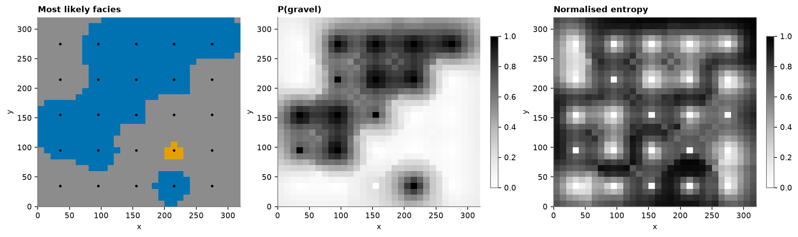
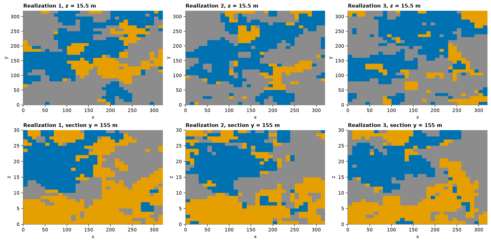
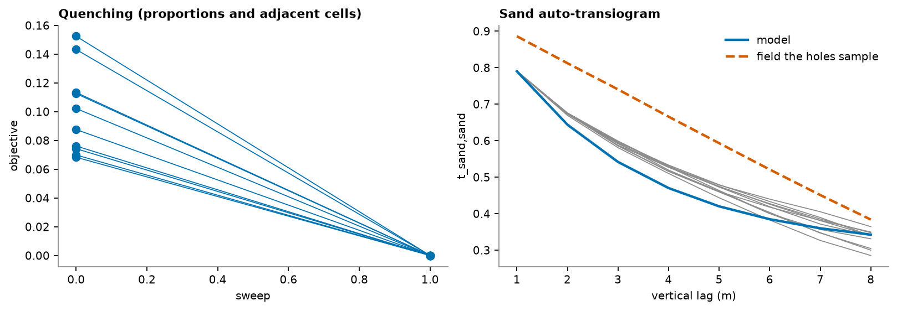

# T-PROGS simulation

Transition-probability cokriging estimates the probability of each facies at a cell from the
nearest hard data, with the transition model in place of covariances. T-PROGS simulates cells
along a random path from those probabilities, then quenches each realization towards the model
transiograms. Hard cells never change.

```python
import matplotlib.pyplot as plt
import numpy as np
import transiograms as tg

ACCENT, GRAY, HIGHLIGHT = "#0072b2", "#8c8c8c", "#d55e00"

d = tg.datasets.layered_drillholes(seed=0)
names = tg.Categories(["mud", "sand", "gravel"], colors=["#8c8c8c", "#e69f00", "#0072b2"])
grid = tg.Grid.from_json(d["grid"])
model = tg.TransitionModel.from_json(d["model"])
xyz = np.column_stack([d["X"], d["Y"], d["Z"]])
print(grid, len(d["CODE"]), "composites")
```

```text
Grid(origin=[0.0, 0.0, 0.0], size=[10.0, 10.0, 1.0], count=[32, 32, 30]) 750 composites
```

Cokriged probabilities and the most likely facies on a horizontal slice at 15.5 m, through the
25 holes.

```python
pred = tg.tp_cokriging(model, grid, xyz, d["CODE"])
print(f"clipped and renormalised at {pred.corrected:.1%} of cells")
fig, axes = plt.subplots(1, 3, figsize=(13, 3.8), layout="constrained")
tg.plot.grid_slice(pred.most_likely, grid, index=15, categories=names, ax=axes[0])
axes[0].plot(d["X"], d["Y"], "k.", ms=3)
axes[0].set_title("Most likely facies")
tg.plot.grid_slice(pred.probabilities[:, 2], grid, index=15, ax=axes[1], vmin=0, vmax=1)
axes[1].set_title("P(gravel)")
tg.plot.grid_slice(pred.entropy, grid, index=15, ax=axes[2], vmin=0, vmax=1)
axes[2].set_title("Normalised entropy")
fig.savefig("cokriging.png")
```

```text
clipped and renormalised at 0.0% of cells
```



Ten realizations. Each takes its own seeded path and draws, so the result does not depend on
the number of threads.

```python
real = tg.tprogs_simulate(model, grid, xyz, d["CODE"], n=10, seed=0)
print(f"{len(real)} realizations of {grid.n_cells} cells")
cells, codes = grid.snap(xyz, d["CODE"])
print("hard data honoured in every realization:", bool(np.all(real.realizations[:, cells] == codes)))
print("ensemble proportions:", real.proportions.mean(axis=0).round(3), "model:", model.proportions)
fig, axes = plt.subplots(2, 3, figsize=(13, 6.4), layout="constrained")
for r, ax in enumerate(axes[0]):
    tg.plot.grid_slice(real.realizations[r], grid, index=15, categories=names, ax=ax)
    ax.set_title(f"Realization {r + 1}, z = 15.5 m")
for r, ax in enumerate(axes[1]):
    tg.plot.grid_slice(real.realizations[r], grid, axis="y", index=15, categories=names, ax=ax)
    ax.set_title(f"Realization {r + 1}, section y = 155 m")
fig.savefig("realizations.png")
```

```text
10 realizations of 30720 cells
hard data honoured in every realization: True
ensemble proportions: [0.5   0.3   0.199] model: [0.5 0.3 0.2]
```



Quenching never raises its objective. The objective counts only the proportions and the lags
between adjacent cells (closeness above `quench_limit`), so its fall to near zero says nothing
about longer lags. From 2 m down, the sand auto-transiograms of the realizations sit above the
model, between it and the field the holes were drawn from: the hard data carry the field's
longer sand beds (the transiograms page shows how far the dataset's field is from its model).

```python
fig, (a, b) = plt.subplots(1, 2, figsize=(10, 3.4), layout="constrained")
for o in real.objective:
    a.plot(o, marker="o", color=ACCENT, lw=0.8)
a.set(xlabel="sweep", ylabel="objective", title="Quenching (proportions and adjacent cells)")
lags = np.arange(1, 9)
ensemble = []
for r in real.realizations:
    e = tg.grid_transiogram(r, grid, offset=(0, 0, 1), n_lags=8)
    ensemble.append(e.probabilities[:, 1, 1])
    b.plot(lags, e.probabilities[:, 1, 1], color=GRAY, lw=0.8)
target = model.transition(np.outer(lags, [0.0, 0.0, 1.0]))[:, 1, 1]
field = tg.grid_transiogram(d["field"], grid, offset=(0, 0, 1), n_lags=8).probabilities[:, 1, 1]
b.plot(lags, target, color=ACCENT, lw=2, label="model")
b.plot(lags, field, color=HIGHLIGHT, lw=2, ls="--", label="field the holes sample")
b.set(xlabel="vertical lag (m)", ylabel="t_sand,sand", title="Sand auto-transiogram")
b.legend()
print("lag (m):            ", lags[:6])
print("model:              ", target[:6].round(3))
print("realizations (mean):", np.mean(ensemble, axis=0)[:6].round(3))
print("field:              ", field[:6].round(3))
fig.savefig("reproduction.png")
```

```text
lag (m):             [1 2 3 4 5 6]
model:               [0.79  0.644 0.542 0.47  0.42  0.385]
realizations (mean): [0.791 0.674 0.591 0.524 0.467 0.415]
field:               [0.886 0.812 0.741 0.666 0.593 0.521]
```



`tg.fit_quality` puts the reproduction in numbers: ensemble proportions against the model, and
the largest gap between ensemble and model transiograms at lags 1 to 6 along +x, +y, +z and -z,
also in standard errors of the ensemble mean. The quench holds the proportions; the
transiogram gap is the limit described in the T-PROGS guide.

```python
q = tg.fit_quality(model, grid, real)
print(q)
```

```text
FitQuality(n=10, k=3, offsets=24, proportion_error=0.0006, transiogram_error=0.1480, max_standard_errors=42.6)
```

Full script: [`example_05_01.py`](example_05_01.py)
